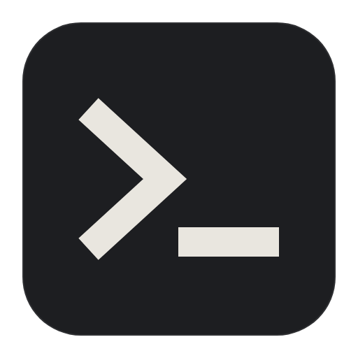
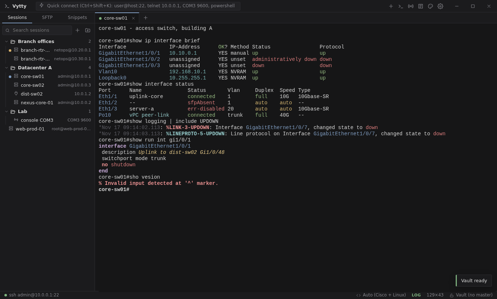
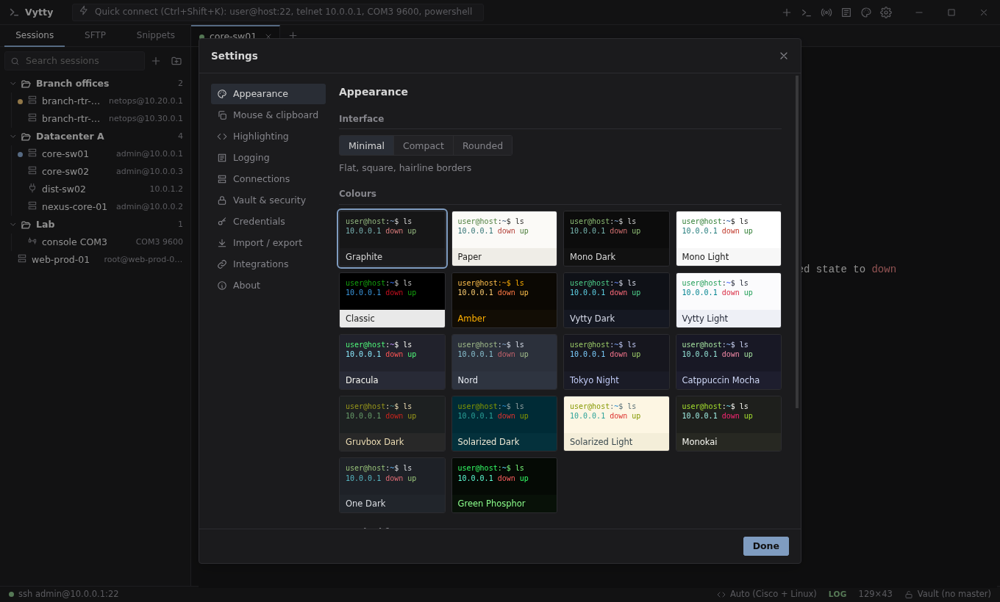

<p align="center">
  
</p>

<h1 align="center">Vytty</h1>

<p align="center">
  <b>A portable, minimal terminal for network and Linux work.</b><br>
  SSH · Telnet · Serial · Local shells · SFTP · Encrypted password vault · Daily logs · Cisco / Nexus / Linux highlighting<br>
  Imports from MobaXterm, PuTTY, SecureCRT, mRemoteNG and OpenSSH · NetBox sync · Verified updates
</p>

<p align="center">
  
</p>

Vytty takes the parts of MobaXterm and SecureCRT that you use every day and leaves out the rest. It is one
portable executable: no installer, no registry. Sessions, settings, the vault and logs all live in a
`VyttyData` folder next to the `.exe`, so you can carry the whole setup on a USB stick.

## Features

**Connections**
- SSH (password, private key incl. `.ppk`, Pageant/OpenSSH agent, keyboard-interactive/MFA)
- SSH jump host (bastion), local port forwarding and SOCKS5 dynamic forwarding
- "Legacy algorithms" switch for old Cisco IOS boxes (`diffie-hellman-group1`, `ssh-rsa`, `aes-cbc`)
- Telnet with NAWS/TTYPE negotiation and **auto-login** (answers `Username:` / `Password:` prompts)
- Serial console (COM ports; baud, data bits, parity, stop bits, flow control)
- Local shells: PowerShell, pwsh, CMD, WSL, Git Bash, bash/zsh
- Host key verification with a `known_hosts` store and a loud warning when a key changes

**Sessions**
- Session tree with folders and subfolders, drag & drop, search (name, host, user, folder, notes)
- Multi-select in the tree (Ctrl / Shift click, Ctrl+A) to move, delete or set a credential on many sessions at once (Delete key)
- Per-session name, color, highlight profile, logging on/off, startup commands and notes
- Quick connect bar: `user@host:22`, `ssh -p 2222 host`, `telnet 10.0.0.1 23`, `COM3 9600`, `powershell`
- Duplicate, open all sessions in a folder, save a quick-connect tab as a session
- Import / export (passwords optionally included, encrypted with an export password)
- **Import from MobaXterm** (`.mxtsessions` / `MobaXterm.ini`): folders (nested), hosts, ports, users, key paths, SSH gateways and serial settings for hundreds of sessions at once; SSH/Telnet/Serial/Shell/SFTP mapped, other types skipped and reported — reads the username from the session field, the host (`user@host`) or the session name, so it lines up with your credentials

**Integrations**
- **Import** sessions from **MobaXterm**, **PuTTY / KiTTY** (`.reg` export), **SecureCRT** (XML export or the session
  folder), **mRemoteNG** (`confCons.xml`, passwords included), **OpenSSH** `~/.ssh/config` (ProxyJump, forwards) and
  **CSV** (Excel, CMDB / IPAM exports). Importing the same file twice does not duplicate anything
- **Export** to an OpenSSH config, CSV and an **Ansible** inventory (groups from folders, `ansible_network_os` from
  the highlighting profile)
- **NetBox**: every device (and optionally VM) becomes a session, in folders by site / role / tenant; syncing again
  updates them. The API token is kept in the vault
- **ssh:// and telnet:// links** (Windows, opt-in): links in NetBox, Zabbix, LibreNMS or a wiki open a tab in Vytty -
  the saved session for that host if there is one
- **Open with**: WinSCP, FileZilla, PuTTY, Windows Terminal, Remote Desktop, VNC, a device's web UI or any program
  from a session's menu, plus ping and traceroute in a tab

**Password vault**
- Every saved session can have its own password / key passphrase
- AES-256-GCM, key derived with scrypt from a master password that is never stored
- Optional "no master password" mode for convenience (clearly labelled as obfuscation only)
- Passwords typed at connect time can be saved to the vault with one checkbox
- **Credentials** (like MobaXterm user credentials): named username + password pairs. A session can pick one, or with
  *auto* on, every session whose username matches uses that password, so one entry covers all devices with the same
  login. A password saved in the session itself always wins.

**Syntax highlighting**
- Profiles: **Cisco IOS / IOS-XE (Catalyst)**, **Cisco NX-OS (Nexus)**, **Linux**, **Auto** (all of them) or none
- Interfaces (`GigabitEthernet1/0/1`, `Te1/1/1`, `Eth1/1`, `Po10`, `Vlan10`, `mgmt0`…), IPv4/IPv6, MAC addresses
- Up/down/err-disabled/sfpAbsent/notconnect states, syslog mnemonics coloured by severity (`%LINK-3-UPDOWN`)
- CLI errors (`% Invalid input`), prompts, config sections, `no` commands, descriptions, route codes
- Linux: `[  OK  ]` / `[FAILED]`, error/warning words, disk usage percentages, dates
- Output that is already coloured by the remote side, and full-screen apps (vim, htop, less), are left untouched
- Custom regex rules with a live preview

**Logging**
- One log file per device and day: `VyttyData/logs/<hostname>#YYYY-MM-DD.log`
- The hostname is read from the device prompt (`SW1#`, `SW1(config)#`, `user@host:~$`), so every session to the
  same device that day **appends** to the same file, with OPEN/CLOSE markers - whether you connected by IP or name.
  Hopping from a jump host to another device switches to that device's file. Without a recognisable prompt the
  session's host address is used
- Optional `[HH:MM:SS]` and `[session name]` prefix on every line; escape codes and backspaces are cleaned up
- Log folder is configurable

**Quality of life (MobaXterm-style)**
- Copy on select, paste on right click, paste on middle click (all configurable; Shift+right click = menu)
- Confirmation before pasting multiple lines
- **Multi-exec**: type once into every tab at the same time (per-tab opt-out)
- SFTP side panel for the active SSH tab:
  - cached listings, so folders and tabs switch instantly; folders are prefetched when you hover them
  - **drag files out** to Explorer / the desktop to download, **drag files or whole folders in** to upload
  - big files work too: drag a 10 GB video to the desktop and let go right away - the file appears there and
    downloads in the background with progress in the status bar (small files are dragged as real files, so they
    can also be dropped into other apps)
    (drop onto a folder row to upload into that folder, or onto the terminal to upload to the current folder)
  - multi-select (Ctrl / Shift), recursive folder download, upload and delete, rename, new folder, "cd here"
  - keyboard: Enter, Backspace (parent folder), Delete, F2, F5, Ctrl+A
- Snippets / macros: the list starts empty; add your own and send them with one click (`\n` = Enter, `\x03` = Ctrl+C)
- Press **R** in a disconnected tab to reconnect
- Find in scrollback (regex, match case), Ctrl+wheel zoom, clickable links (Ctrl+click)
- Tab rename, drag to reorder, color, activity indicator, close others / to the right
- Visual or audible bell, 20 000 lines of scrollback (configurable)

**Look**

Three interface styles - **Minimal** (flat, square, hairline borders; the default), **Compact** (denser, for long
session lists) and **Rounded** - and 18 themes that colour both the UI and the terminal: Graphite, Paper, Mono Dark,
Mono Light, Classic, Amber, Vytty Dark, Vytty Light, Dracula, Nord, Tokyo Night, Catppuccin Mocha, Gruvbox Dark,
Solarized Dark, Solarized Light, Monokai, One Dark, Green Phosphor.

<p align="center"></p>

## Download

Grab a file from the [Releases](https://github.com/mtgmz14/vytty/releases) page:

| File | |
| --- | --- |
| `Vytty-x.y.z-portable.exe` | one file; put it in a folder of its own (e.g. `C:\Tools\Vytty`) and run it |
| `Vytty-x.y.z-win-x64.zip` | the same app as a plain folder: unzip and run `Vytty.exe`. **Best for work PCs** with endpoint protection - no self-extracting launcher |
| `Vytty-x.y.z.AppImage` | Linux |

The first start creates `VyttyData` next to the program and asks you to set up the vault. The portable `.exe`
unpacks the app once per version (~7 s) to `%LOCALAPPDATA%\Vytty\app\<version>`; every later start runs that copy
(~1 s) and the `.exe` itself is not kept open.

**Verifying a download.** `SHA256SUMS.txt` in every release lists the SHA-256 of each file (`Get-FileHash` on
Windows, `sha256sum -c --ignore-missing SHA256SUMS.txt` on Linux), and `gh attestation verify <file> --repo
mtgmz14/vytty` proves the file was built by this repository's GitHub Actions workflow.

**Updates.** Vytty checks for new releases at startup and every 6 hours and asks before it does anything. An update
is installed only when its SHA-256 matches the release's checksum list *and* that list carries a valid Ed25519
signature from the key built into Vytty - a modified or corrupted file is refused. The portable `.exe` is not
replaced while in use: the new version is saved next to it and started, and the old file is removed after the new
version has started. No helper programs or scripts are involved. In **Settings → About** you can switch to *Only
tell me* (Vytty never downloads anything - the right choice on managed work PCs) or turn the check off. Copies
installed with winget are updated with `winget upgrade`.

**Endpoint protection (CrowdStrike, Defender).** The binaries are not code-signed yet, so machine-learning based
scanners may flag a new release. See [docs/PODPISYWANIE.md](docs/PODPISYWANIE.md) (Polish) for what triggers it, what
0.10 changed, free signing options and what to send to your security team.

## Migrating from MobaXterm, PuTTY, SecureCRT, mRemoteNG

**Settings → Import / export → Import from other tools** reads:
- **PuTTY / KiTTY**: `reg export HKCU\Software\SimonTatham\PuTTY\Sessions putty.reg` (KiTTY:
  `HKCU\Software\9bis.com\KiTTY\Sessions`), then import `putty.reg`
- **SecureCRT**: *File → Export Settings… → XML*, or point Vytty at the session folder
  (`%APPDATA%\VanDyke\Config\Sessions`)
- **mRemoteNG**: `confCons.xml` (usually `%APPDATA%\mRemoteNG`); its passwords go into Vytty's vault (a protected
  file asks for its master password)
- **OpenSSH**: `~/.ssh/config` - `Host *` defaults, `ProxyJump` (as a jump host), `LocalForward` / `DynamicForward`
- **CSV**: a header row with any of `name, host, port, protocol, username, folder, notes, key, serial, baud, platform`

### MobaXterm

In MobaXterm, right-click **User sessions → Export all sessions to file** (or a folder → *Export sessions from this folder*) to get a `.mxtsessions` file. In Vytty open **Settings → Import / export → Import MobaXterm sessions…** and pick that file. Folders (including nested ones), hostnames, ports, usernames, private-key paths, SSH gateways and serial parameters are imported in one go, for hundreds of sessions at a time. SSH, Telnet, Serial, Shell and SFTP sessions are mapped; RDP/VNC/browser and other types Vytty does not speak are skipped and counted in the summary.

**Passwords:** MobaXterm session files never contain them — MobaXterm keeps passwords encrypted in the Windows registry, tied to your Windows account. Right after the import Vytty lists the usernames it found (e.g. `admin · 281 sessions`, `cisco · 12 sessions`) and lets you enter **one password per username**; each becomes an *auto* credential, so all 281 `admin` sessions log in with it. You can manage these later in **Settings → Credentials**. For per-host passwords there is also **Add passwords in bulk…**: paste one line per session (`host user password`, `host password`, or `name password`, separated by Tab, comma or two spaces) and Vytty matches each to the imported session and stores it in its own encrypted vault. Or just let Vytty save each password the first time you connect.

## Keyboard shortcuts

| Shortcut | Action |
| --- | --- |
| `Ctrl+Shift+N` | New session |
| `Ctrl+Shift+K` | Quick connect |
| `Ctrl+Shift+E` | Search sessions |
| `Ctrl+Shift+T` | Duplicate tab |
| `Ctrl+Shift+W` | Close tab |
| `Ctrl+Tab` / `Ctrl+Shift+Tab` | Next / previous tab |
| `Alt+1` … `Alt+9` | Go to tab |
| `Ctrl+Shift+C` / `Ctrl+Insert` | Copy |
| `Ctrl+Shift+V` / `Shift+Insert` | Paste |
| `Ctrl+Shift+F` | Find |
| `Ctrl+Shift+M` | Toggle multi-exec |
| `Ctrl+Shift+R` | Reconnect |
| `Ctrl+Shift+L` | Clear scrollback |
| `Ctrl+Shift+B` | Toggle sidebar |
| `Ctrl+=` / `Ctrl+-` / `Ctrl+0` | Zoom in / out / reset |
| `Ctrl+,` | Settings |
| `F11` | Full screen |

## Data folder

```
Vytty-0.10.0-portable.exe
VyttyData/
  settings.json      UI and terminal settings, snippets
  sessions.json      folders and sessions (no passwords)
  vault.json         encrypted credentials
  known_hosts.json   trusted SSH host key fingerprints
  logs/SW-CORE-01#2026-09-26.log
```

## Code signing policy

The Windows binaries are not Authenticode-signed yet; the release workflow is prepared for signing through the
SignPath Foundation (free for open source), a certificate file or Azure Artifact Signing. The policy - who builds,
reviews and approves signed releases - and the privacy statement are in [SECURITY.md](SECURITY.md).

## Building from source

Requirements: Node.js 20+ and npm.

```bash
git clone https://github.com/mtgmz14/vytty.git
cd vytty
npm install
npm start            # run from source (data goes to ./data)
npm test             # unit and integration tests (SSH / Telnet against local test servers)
npm run test:e2e     # end-to-end: drives the app without a window (Linux needs no display)
npm run dist:win     # dist/Vytty-<version>-win-x64.zip and -portable.exe (needs NSIS for the latter)
npm run dist:linux   # build an AppImage
```

Pushing a `v*` tag runs the tests, builds Windows and Linux binaries, starts each one once as a smoke test, signs
the checksum list for the updater, attests the build provenance and publishes the release.

## Tech

Electron, [xterm.js](https://xtermjs.org/), [ssh2](https://github.com/mscdex/ssh2), [serialport](https://serialport.io/),
[node-pty](https://github.com/microsoft/node-pty). The renderer is plain JavaScript with no framework and runs
sandboxed with context isolation; all network and file access goes through a small preload API.

## Roadmap

- Split panes inside a tab
- X11 forwarding
- Microsoft Store (MSIX) and winget packages

## Po polsku

Vytty to przenośny (portable) terminal SSH / Telnet / Serial dla sieciowców i adminów Linuksa: drzewo sesji z
folderami, zaszyfrowany sejf haseł dla każdej sesji, podświetlanie składni Cisco Catalyst / Nexus / Linux, dzienne
pliki logów per urządzenie (`hostname#RRRR-MM-DD.log` - wszystkie sesje na to samo urządzenie danego dnia dopisują
się do jednego pliku), kopiowanie po zaznaczeniu i wklejanie prawym przyciskiem, multi-exec, panel SFTP, snippety,
18 motywów w trzech stylach (Minimal, Compact, Rounded) i weryfikowane automatyczne aktualizacje (podpis Ed25519,
bez skryptów pomocniczych, tryb „tylko powiadamiaj” dla komputerów służbowych). Import sesji z MobaXterm, PuTTY,
SecureCRT, mRemoteNG, `~/.ssh/config` i CSV, eksport do `ssh_config`, CSV i inwentarza Ansible, synchronizacja
z NetBoxem, obsługa linków `ssh://` / `telnet://` i „Otwórz w…” (WinSCP, PuTTY, RDP...). Wszystkie dane są
w folderze `VyttyData` obok pliku `Vytty.exe`. Audyt wersji 0.10: [docs/AUDYT-0.10.0.md](docs/AUDYT-0.10.0.md),
podpisywanie i CrowdStrike: [docs/PODPISYWANIE.md](docs/PODPISYWANIE.md).

## License

[MIT](LICENSE)
